# CIP-B101 Lab 1B: PC System Fundamentals, Disk Sectors and Partition Analysis

**International Cybersecurity and Digital Forensics Academy (ICDFA)**
**Course:** CIP-B101 | Basic Computer Skills for Digital Forensics
**Author:** Chukwu Udochukwu Godwin


> A read-only system profile: hardware and OS identification, process observation, sector-level partition calculations, boot process analysis and file system identification.

---

## Table of Contents

1. [Introduction](#1-introduction)
2. [Tools and Environment](#2-tools-and-environment)
3. [Safety and Evidence Handling](#3-safety-and-evidence-handling)
4. [Part A: System Identification and Evidence Layer Mapping](#4-part-a-system-identification-and-evidence-layer-mapping)
5. [Part B: Program, Process and Thread Investigation](#5-part-b-program-process-and-thread-investigation)
6. [Part C: Disk Sector and Disk Size Calculation](#6-part-c-disk-sector-and-disk-size-calculation)
7. [Part D: Safe Partition Table Inspection](#7-part-d-safe-partition-table-inspection)
8. [Part E: MBR, GPT and Boot Process](#8-part-e-mbr-gpt-and-boot-process)
9. [Part F: File System Identification](#9-part-f-file-system-identification)
10. [Part G: Final Practical Assignment](#10-part-g-final-practical-assignment)
11. [Conclusion](#11-conclusion)
12. [Figure Index](#12-figure-index)
13. [Repository Structure](#13-repository-structure)
14. [References](#14-references)

---

## 1. Introduction

**Scenario:** As a junior digital forensic trainee, I prepared an initial system profile of a computer that may later be used in an investigation. The work covers identifying the system and its evidence layers, inspecting the disks and partitions, calculating partition sizes from sector data, explaining the boot process and identifying the file systems in use, all without altering the machine.

**Forensic mindset:** observe, record, calculate, verify and document in a repeatable way. Nothing on the machine was changed.

### Learning Outcomes

- Explain how system layers generate digital evidence.
- Identify hardware, OS, storage, memory and processor information.
- Differentiate a program, a process and a thread.
- Calculate disk and partition sizes from sector count and sector size.
- Use read-only commands to view disk and partition information.
- Explain the PC boot process and compare MBR and GPT.
- Identify common file systems and explain their forensic value.

---

## 2. Tools and Environment

| Item | Detail |
| --- | --- |
| Host system | FUJITSU LIFEBOOK SH782, Windows 11 Home (10.0.22631, Build 22631) |
| Linux environment | Ubuntu on WSL2 |
| Windows tools | System Information (`msinfo32`), Command Prompt, PowerShell, Disk Management, DiskPart, Task Manager |
| Linux tools | `lsblk`, `fdisk`, `parted`, `blkid`, `df` (read-only use) |
| Calculation | Manual formulas, verified against OS-reported byte sizes |

---

## 3. Safety and Evidence Handling

- No disk was formatted, deleted, resized, encrypted or partitioned.
- DiskPart was used only for `list disk`, `select disk 0` and `list partition`.
- All PowerShell and Linux commands were listing or information commands.
- Disk serial numbers are blurred in the published screenshots (Figures 2 and 7a). Partition sizes and file system evidence are left intact.

---

## 4. Part A: System Identification and Evidence Layer Mapping

### A1. System Specification

Opened with `Win + R`, `msinfo32`.

**Figure 1.** System Information summary.

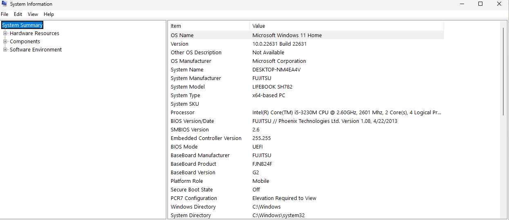

| Property | Value |
| --- | --- |
| OS | Microsoft Windows 11 Home, 10.0.22631 Build 22631 |
| System manufacturer / model | FUJITSU / LIFEBOOK SH782 |
| System type | x64-based PC |
| Processor | Intel Core i5-3230M @ 2.60 GHz, 2 cores, 4 logical processors |
| BIOS | FUJITSU // Phoenix Technologies Ltd. v1.08, 4/22/2013 |
| BIOS mode | UEFI |
| Secure Boot state | Off |
| Platform role | Mobile |

### A2. Storage Information

```cmd
wmic diskdrive get model,size,serialnumber
wmic logicaldisk get caption,filesystem,size,freespace,volumename
```

**Figure 2.** Storage models, sizes and logical disks (serial numbers blurred).

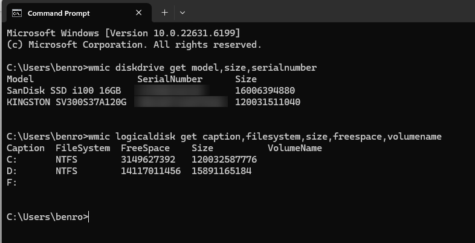

| Model | Size (bytes) |
| --- | --- |
| SanDisk SSD i100 16GB | 16,006,394,880 |
| KINGSTON SV300S37A120G | 120,031,511,040 |

| Drive | File system | Size (bytes) | Free (bytes) |
| --- | --- | --- | --- |
| C: | NTFS | 120,032,587,776 | 3,149,627,392 |
| D: | NTFS | 15,891,165,184 | 14,117,011,456 |
| F: | none reported (optical drive) | | |

### A3. Evidence Sources Mapped to System Layers

User activity = Applications + Operating System + Disk/Memory.

| Layer / Source | Example Evidence | Where It May Be Found | Why It Matters |
| --- | --- | --- | --- |
| User layer | Opened files, searched terms, typed usernames | Recent files, browser history, shell history | Links user action to system activity |
| Application layer | Office document metadata, browser cache, chat logs | Application folders and databases | Shows what software created or used evidence |
| OS layer | Event logs, installed programs, user profiles | Windows logs, registry, Linux `/var/log` | Shows system events and account activity |
| Disk layer | Deleted files, file fragments, partitions | File system and unallocated space | Supports recovery and timeline analysis |
| Memory / process layer | Running malware, PIDs, network connections | RAM capture, process list | Shows live system behaviour |

**Why evidence may exist in more than one layer:** a single user action passes through the application, the operating system, the disk and memory. When a user opens a document, the application may add it to a recent files list, the OS may log the file access, the disk holds the document and its metadata, and memory holds information about the running application. Examining several layers lets an investigator corroborate findings, reconstruct activity, build a more reliable timeline and avoid conclusions drawn from one incomplete source.

---

## 5. Part B: Program, Process and Thread Investigation

### B1. Observing Running Processes

**Figure 3.** Task Manager, Processes tab (9 apps and 50 background processes at capture time).

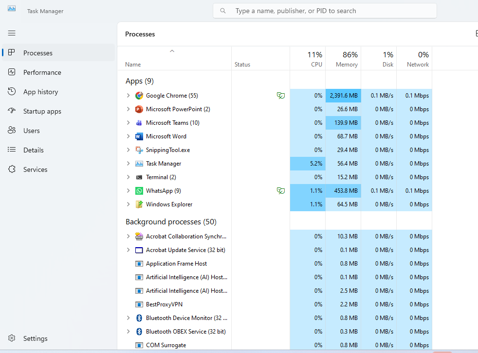

**Figure 4.** Task Manager, Details tab, showing PID values.

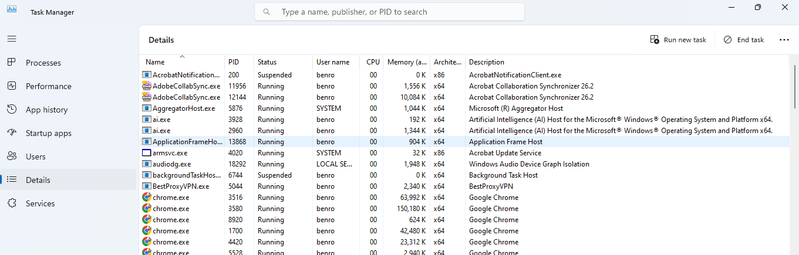

| Process name | PID | User | Likely purpose |
| --- | --- | --- | --- |
| `chrome.exe` | 3516 | benro | Google Chrome browser process |
| `ApplicationFrameHost.exe` | 13868 | benro | Hosts and displays Windows app windows (Application Frame Host) |
| `audiodg.exe` | 18292 | LOCAL SERVICE | Windows Audio Device Graph Isolation |

### B2. Program, Process and Thread

- **Program:** a set of instructions stored on a storage device that does nothing until a user or the OS starts it. Google Chrome installed on a computer is a program.
- **Process:** a running instance of a program. The OS creates one or more processes when Chrome is opened, and gives each a unique Process ID (PID) so it can identify and manage it.
- **Thread:** the smallest unit of execution inside a process. A process can contain many threads working simultaneously, such as a browser handling user input, page loading and background tasks.

**Why process information matters in malware analysis and live triage**

- It helps identify suspicious or unfamiliar programs, unusual resource use, and processes running under unexpected names or from unexpected locations.
- PIDs let an investigator correlate running processes with network connections, loaded modules and other system evidence.
- Some evidence exists only in memory and disappears when the system is shut down, so process information should be collected while the machine is running.

---

## 6. Part C: Disk Sector and Disk Size Calculation

> **Key formula:** size = number of sectors × bytes per sector. Divide bytes by 1024³ to convert to GiB (the lab labels this "GB").

### C1. Slide Calculation

Given: 400 sectors per track, 12 heads, 17,000 cylinders, 512 bytes per sector.

| Item | Formula | Answer |
| --- | --- | --- |
| Total sectors | 400 × 12 × 17,000 | 81,600,000 sectors |
| Total bytes | 81,600,000 × 512 | 41,779,200,000 bytes |
| Kilobytes | 41,779,200,000 / 1024 | 40,800,000 KB |
| Megabytes | 40,800,000 / 1024 | 39,843.75 MB |
| Gigabytes | 39,843.75 / 1024 | 38.91 GB |

### C2. My Own Partitions

**Figure 5.** `Get-Disk` and `Get-Partition` output used for the calculations.

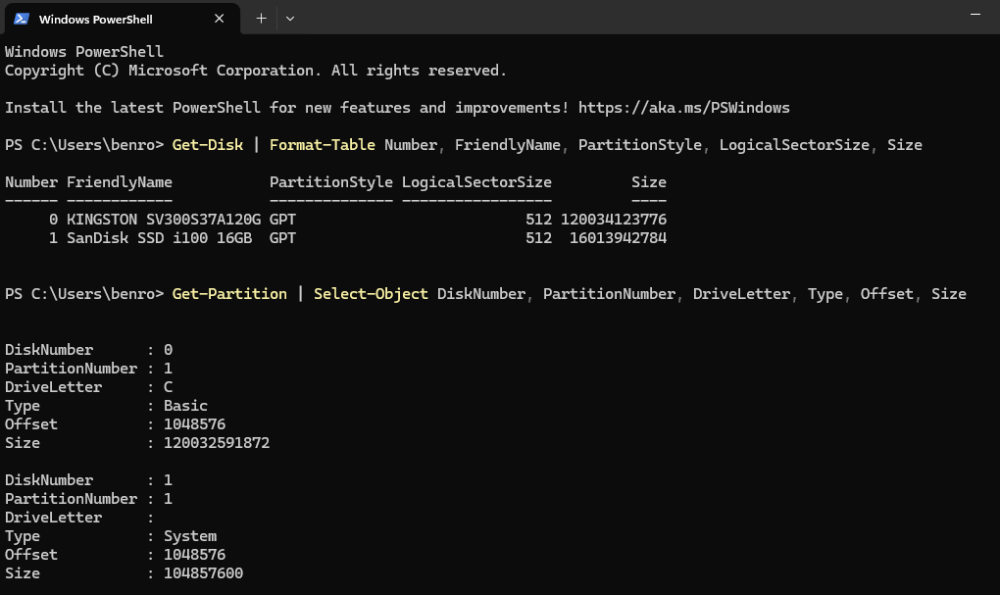

**Table 1.** Partition data collected.

| Property | Partition 1 (C:) | Partition 2 (D:) |
| --- | --- | --- |
| Disk number | 0 | 1 |
| Partition number | 1 | 3 |
| Starting offset (bytes) | 1,048,576 | 122,683,392 |
| Partition size (bytes) | 120,032,591,872 | 15,891,169,280 |
| Sector size (bytes) | 512 | 512 |
| File system | NTFS | NTFS |

**Step 1. Starting sector** = starting offset / sector size

- C: `1,048,576 / 512 = 2,048`
- D: `122,683,392 / 512 = 239,616`

**Step 2. Number of sectors** = partition size / sector size

- C: `120,032,591,872 / 512 = 234,438,656 sectors`
- D: `15,891,169,280 / 512 = 31,037,440 sectors`

**Step 3. Size in GiB** = sectors × sector size / 1024³

- C: `234,438,656 × 512 / 1,073,741,824 = 120,032,591,872 / 1,073,741,824 = 111.79 GiB`
- D: `31,037,440 × 512 / 1,073,741,824 = 15,891,169,280 / 1,073,741,824 = 14.80 GiB`

**Table 2.** Summary.

| Partition | Start sector | Number of sectors | Sector size | File system | Size (GiB) |
| --- | --- | --- | --- | --- | --- |
| C: (Disk 0) | 2,048 | 234,438,656 | 512 bytes | NTFS | 111.79 |
| D: (Disk 1) | 239,616 | 31,037,440 | 512 bytes | NTFS | 14.80 |

### Forensic Interpretation

The C: partition on Disk 0 is about 111.79 GiB and the D: partition on Disk 1 is about 14.80 GiB. Both use NTFS with a 512-byte logical sector size. Partition information tells an investigator how storage is organised, where data lives, and where partition boundaries fall during imaging and examination.

**Comparison with Windows volume reporting.** `Get-Partition` reports the partition extent, while `Get-Volume` reports the size presented for the formatted volume.

| Drive | Partition extent (bytes) | Volume size (bytes) | Difference |
| --- | --- | --- | --- |
| C: | 120,032,591,872 | 120,032,587,776 | 4,096 |
| D: | 15,891,169,280 | 15,891,165,184 | 4,096 |

These small differences are reported rather than treated as calculation errors: the volume layer can report a slightly different usable size than the partition extent. Dividing by 1024³ gives GiB technically, although the assignment labels the result "GB".

---

## 7. Part D: Safe Partition Table Inspection

### D1. Windows Method: Disk Management, PowerShell and DiskPart

**Figure 6.** Disk Management showing disk layout and visible partitions.

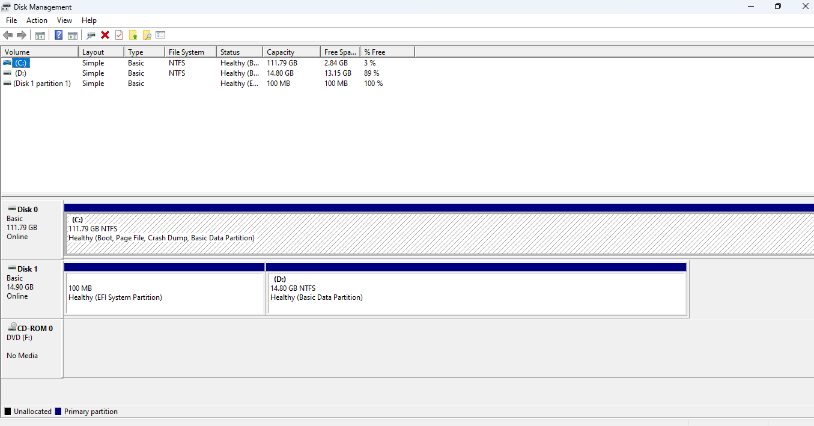

**Figure 7a.** `Get-Disk` and `Get-Partition` (serial numbers blurred).

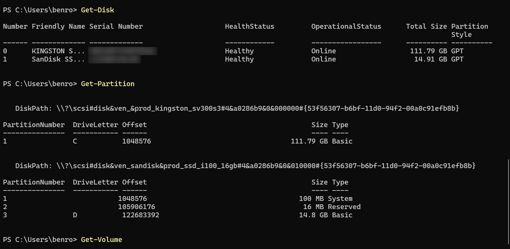

**Figure 7b.** `Get-Volume`.

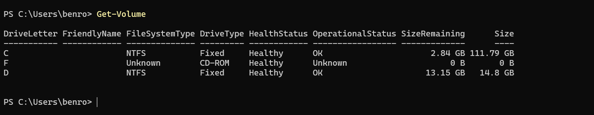

**Figure 8.** DiskPart, listing only: `list disk`, `select disk 0`, `list partition`.

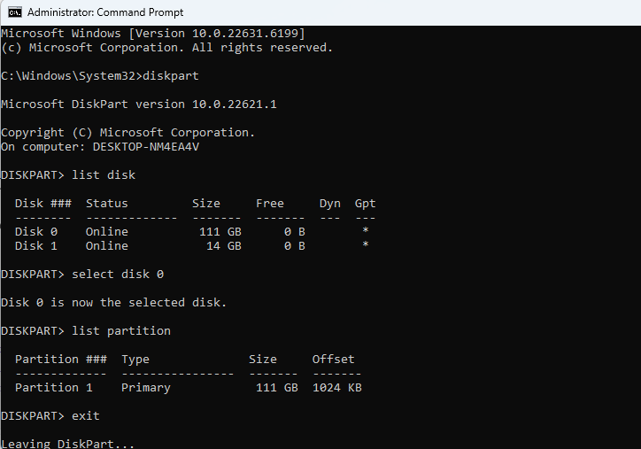

```
diskpart
list disk
select disk 0
list partition
exit
```

**Findings**

| Disk | Device | Partition style | Layout seen |
| --- | --- | --- | --- |
| Disk 0 | KINGSTON SV300S37A120G (111.79 GB) | GPT | One main partition, C: (NTFS) |
| Disk 1 | SanDisk SSD i100 16GB (14.91 GB) | GPT | Partition 1: EFI System (100 MB), Partition 2: Reserved (16 MB), Partition 3: D: (14.8 GB NTFS) |

- Both physical disks use GPT.
- A partition without a drive letter may not appear in `Get-Volume`, so a missing volume entry does not mean the partition is absent.
- DiskPart rounds sizes (111 GB, 14 GB) and lists only the partitions it can see on the selected disk.
- GPT alone does not prove the active firmware boot mode. The separate **BIOS Mode** field in System Information is the evidence for UEFI (see Part E).

### D2. Linux Method: Read-Only Inspection (WSL)

```bash
lsblk -o NAME,SIZE,TYPE,FSTYPE,MOUNTPOINT
sudo fdisk -l
sudo parted -l
blkid
df -h
```

**Figure 9.** `lsblk` and `fdisk -l`.

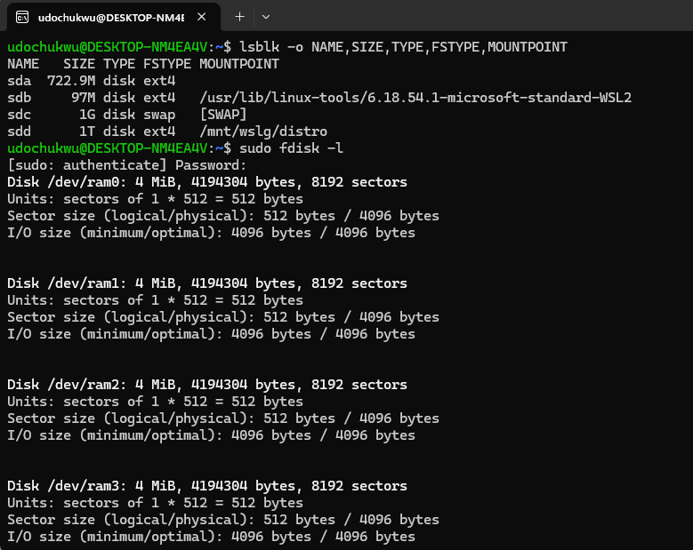

**Figure 10.** `parted`, `blkid` and `df -h`. `parted` was not installed in this WSL environment (`command not found`), so partition information came from `lsblk`, `blkid` and `df`.

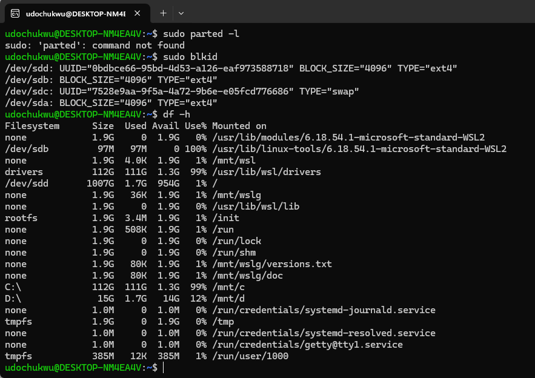

| Device | Size | Type | File system | Mount point |
| --- | --- | --- | --- | --- |
| `/dev/sda` | 722.9 MB | disk | ext4 | |
| `/dev/sdb` | 97 MB | disk | ext4 | `/usr/lib/linux-tools/6.18.54.1-microsoft-standard-WSL2` |
| `/dev/sdc` | 1 GB | disk | swap | `[SWAP]` |
| `/dev/sdd` | 1 TB | disk | ext4 | `/mnt/wslg/distro`, `/` |

### D3. Optional Hex Viewer Method

Not performed. The step is optional, and no hex viewer was used.

---

## 8. Part E: MBR, GPT and Boot Process

### E1. The Boot Process

When a computer is switched on, it initialises its hardware, locates a bootable operating system, loads the kernel and transfers control to the OS.

**Figure 11.** PC boot flow.

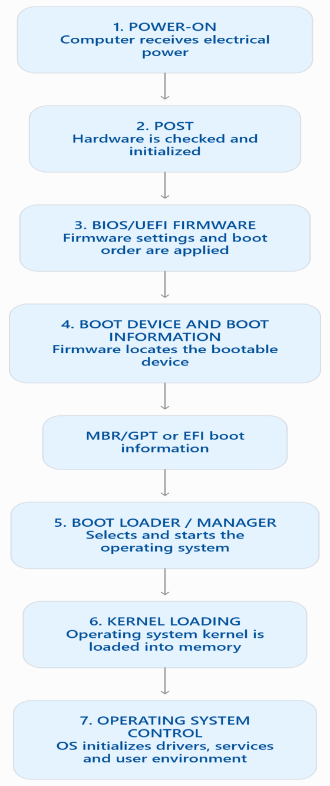

| Stage | What happens | Forensic relevance |
| --- | --- | --- |
| 1. Power-on and POST | The CPU begins executing firmware instructions. POST checks and initialises essential hardware. | Hardware failure or unauthorised hardware changes can affect startup and evidence access. |
| 2. BIOS/UEFI firmware | Firmware initialises hardware, reads its configuration and determines the boot device from the boot order. CMOS-backed settings or UEFI variables preserve the configuration. | Settings reveal boot configuration, boot order and possible changes to startup settings. |
| 3. MBR/GPT or EFI boot | Legacy BIOS commonly uses MBR boot code. UEFI uses EFI boot entries and boot files on the EFI System Partition (commonly FAT32). GPT is the partition structure usually paired with UEFI. | Partition tables, EFI entries and boot files can show additional operating systems or startup changes. |
| 4. Boot loader / manager | Identifies the OS to start and prepares files for kernel loading. Windows uses Windows Boot Manager. | Boot configuration data can reveal multiple operating systems or unusual startup options. |
| 5. Kernel loading | The kernel is loaded into memory, initialises core components, manages memory and prepares drivers. | Memory captures can contain the running kernel, loaded drivers and active components. |
| 6. Kernel and OS control | Control passes to the OS. Services and drivers start and the login screen appears. | OS logs, startup records and user activity provide evidence of system events. |

### My System's Boot Mode

**Figure 12.** System Information showing **BIOS Mode: UEFI**.

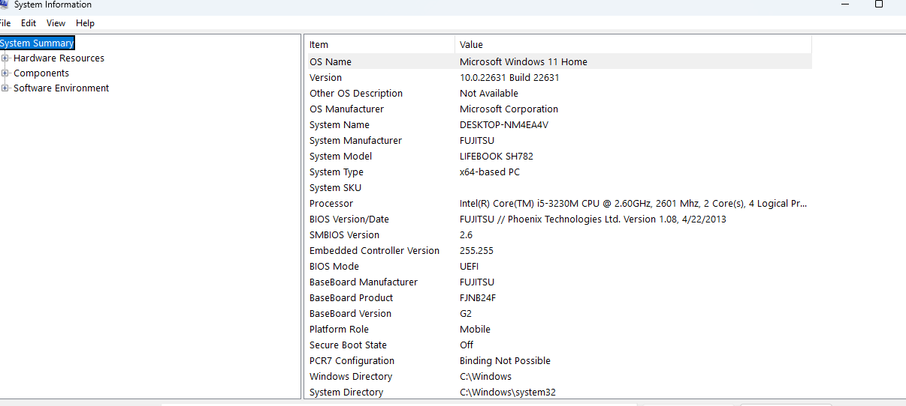

My Windows installation boots using **UEFI** firmware. This is consistent with the GPT partition style found on both disks. In a typical Windows UEFI installation, the firmware uses an EFI boot entry to locate Windows Boot Manager on the EFI System Partition. GPT is a partitioning scheme and UEFI is a firmware boot mode. They are related but not the same, and the BIOS Mode field is the direct evidence of boot mode.

### E2. MBR versus GPT

| Feature | MBR | GPT |
| --- | --- | --- |
| Age / design | Older partitioning system from the 1980s | Modern scheme used with UEFI systems |
| Size limit | Commonly about 2 TB | Very large disks; slide notes up to about 9.4 ZB |
| Partition information | Partition table in the first sector with boot code | Primary and backup GPT headers and partition entries |
| Forensic issue | Critical data sits in sector 0, and damage can affect partition interpretation | Backup structures help recovery and validation |

Both of my disks were identified as GPT by `Get-Disk`. That is consistent with a modern layout, but partition style alone should not be used as the only proof of UEFI boot mode.

---

## 9. Part F: File System Identification

**Figure 13.** `Get-Volume` showing file systems. C: and D: are NTFS. F: has no reported file system and a size of zero (empty optical drive).

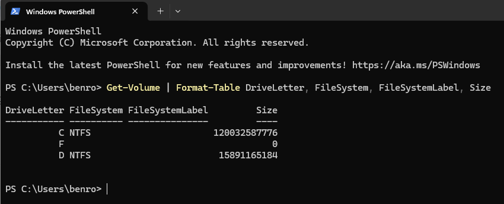

**Figure 14.** Linux `lsblk -f`, `blkid` and `df -Th`: ext4 file systems and a swap partition.

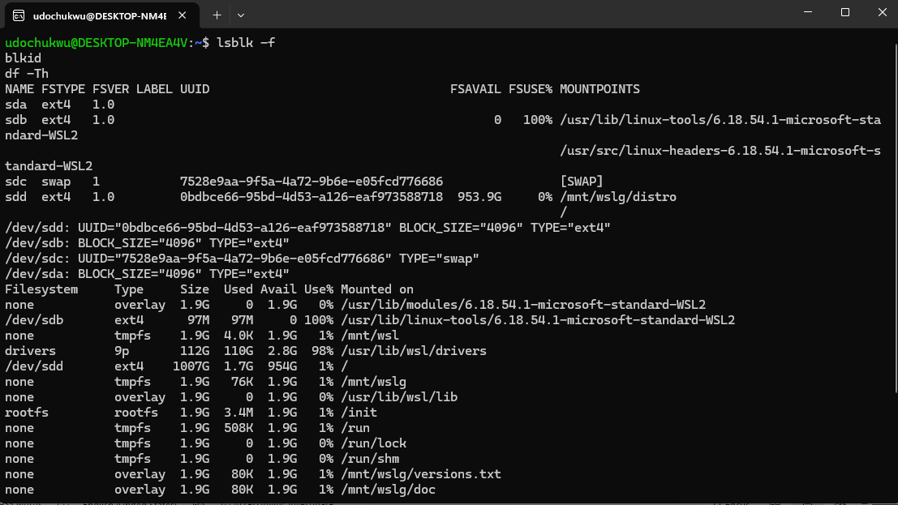

**Table 3.** Common file systems and their forensic importance.

| File system | Common OS / usage | Forensic importance |
| --- | --- | --- |
| FAT/FAT32 | Removable media and older systems | Simple structure, often used on USB drives |
| NTFS | Modern Windows systems | MFT entries, timestamps, permissions and journals |
| ext family | Linux systems | Inode-based metadata, supports forensic timeline analysis |
| XFS/JFS/btrfs | Linux/Unix-like systems | Advanced features may affect recovery and metadata interpretation |
| HFS+ | Older macOS systems | Important in Mac forensic investigations |

**Table 4.** File systems found on this system.

| System | Volume / device | File system | Observation |
| --- | --- | --- | --- |
| Windows | C: | NTFS | Main Windows volume |
| Windows | D: | NTFS | Additional volume |
| Linux (WSL) | `/dev/sdd` | ext4 | Mounted as `/` |
| Linux (WSL) | `/dev/sdb` | ext4 | Linux system storage |
| Linux (WSL) | `/dev/sdc` | swap | Swap partition |

**Interpretation.** `Get-Volume` reported NTFS on C: and D:, the only two mounted volumes with a reported file system. NTFS metadata helps an examiner study file names, directory structure, timestamps, permissions and allocation. The F: entry reported no file system and zero size, so it is not classified. The small System and Reserved partitions on Disk 1 were identified by `Get-Partition`, but their file systems were not established by the `Get-Volume` output. The Linux output shows ext4 and swap, which shows that different environments use different file systems.

**Why file systems matter in digital forensics.** A file system determines how data is organised, stored, named and accessed. It records file locations, timestamps, permissions and allocation status. Investigators use this to identify existing and deleted files, examine metadata, reconstruct user activity and build timelines. Because file systems store information differently, understanding the one in use is necessary to interpret evidence correctly.

---

## 10. Part G: Final Practical Assignment

**Task:** verify the size of partitions 1 and 2 using partition table evidence and calculate each size in GB.

The two partitions used are Partition 1 and Partition 2 on **Disk 1 (SanDisk SSD i100 16GB)**, with a logical sector size of 512 bytes reported by `Get-Disk`.

**Figure 15.** `Get-Partition` output for Disk 0 and Disk 1.

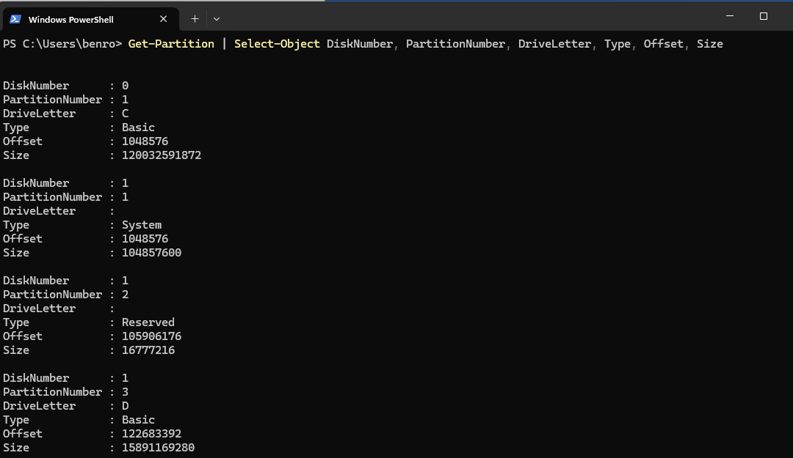

### Partition 1 (Disk 1, Type: System)

| Step | Formula | Result |
| --- | --- | --- |
| Offset (from `Get-Partition`) | | 1,048,576 bytes |
| Size (from `Get-Partition`) | | 104,857,600 bytes |
| Start sector | 1,048,576 / 512 | **2,048** |
| Sector count | 104,857,600 / 512 | **204,800** |
| Inclusive end sector | 2,048 + 204,800 − 1 | **206,847** |
| Size in GiB | 204,800 × 512 / 1,073,741,824 | **0.09765625 GiB** (about 0.098) |

### Partition 2 (Disk 1, Type: Reserved)

| Step | Formula | Result |
| --- | --- | --- |
| Offset (from `Get-Partition`) | | 105,906,176 bytes |
| Size (from `Get-Partition`) | | 16,777,216 bytes |
| Start sector | 105,906,176 / 512 | **206,848** |
| Sector count | 16,777,216 / 512 | **32,768** |
| Inclusive end sector | 206,848 + 32,768 − 1 | **239,615** |
| Size in GiB | 32,768 × 512 / 1,073,741,824 | **0.015625 GiB** (about 0.016) |

### Verification Against OS-Reported Sizes

| Item | Result |
| --- | --- |
| `Get-Partition` size, Partition 1 | 104,857,600 bytes. The calculation reproduces it exactly. |
| `Get-Partition` size, Partition 2 | 16,777,216 bytes. The calculation reproduces it exactly. |
| `Get-Volume` | Does not list these partitions, because neither has a drive letter or mounted volume. |
| Discrepancies | None. Sector count × 512 matches each `Get-Partition` size exactly. Results are in GiB because the divisor is 1024³. No file system overhead is subtracted, because no file system was reported for these two partitions. |

Partition 1 ends at sector 206,847 and Partition 2 starts at sector 206,848, so the two partitions are contiguous. Partition 3 (D:) starts at sector 239,616, immediately after Partition 2 ends at 239,615. Both partitions are small system and reserved partitions rather than the main user-data volume. No file system has been assumed for them.

---

## 11. Conclusion

This lab produced a complete, read-only profile of a Windows 11 system with a WSL2 Linux environment. Both physical disks use GPT, the machine boots in UEFI mode, and the main volumes are NTFS, with ext4 and swap in WSL. Sector-level calculations from the partition table reproduced the OS-reported byte sizes exactly, and the small 4,096-byte gap between partition extents and volume sizes was identified rather than ignored. The work shows why forensic examiners must understand system layers, processes, partition structures, boot sequences and file systems: each one determines where evidence lives, how it is stored and how reliably it can be interpreted.

---

## 12. Figure Index

| Figure | Description | File |
| --- | --- | --- |
| 1 | System Information summary | `images/fig01_msinfo32_system_summary.png` |
| 2 | `wmic` storage information | `images/fig02_wmic_storage_info.png` |
| 3 | Task Manager processes | `images/fig03_task_manager_processes.png` |
| 4 | Task Manager details (PIDs) | `images/fig04_task_manager_details_pid.png` |
| 5 | `Get-Disk` and `Get-Partition` for calculations | `images/fig05_get_disk_get_partition_sector_size.png` |
| 6 | Disk Management | `images/fig06_disk_management.png` |
| 7a | `Get-Disk` and `Get-Partition` | `images/fig07a_get_disk_get_partition.png` |
| 7b | `Get-Volume` | `images/fig07b_get_volume.png` |
| 8 | DiskPart listing | `images/fig08_diskpart_listing.png` |
| 9 | Linux `lsblk` and `fdisk` | `images/fig09_linux_lsblk_fdisk.png` |
| 10 | Linux `parted`, `blkid`, `df` | `images/fig10_linux_parted_blkid_df.png` |
| 11 | Boot process flow | `images/fig11_boot_process_flow.png` |
| 12 | BIOS Mode: UEFI | `images/fig12_msinfo32_bios_mode_uefi.png` |
| 13 | `Get-Volume` file systems | `images/fig13_get_volume_file_systems.png` |
| 14 | Linux file systems | `images/fig14_linux_lsblk_f_file_systems.png` |
| 15 | `Get-Partition` for Part G | `images/fig15_get_partition_part_g.png` |

---

## 13. Repository Structure

```
CIP-B101_Lab1B/
├── README.md
└── images/
    ├── fig01_msinfo32_system_summary.png
    ├── fig02_wmic_storage_info.png
    ├── fig03_task_manager_processes.png
    ├── fig04_task_manager_details_pid.png
    ├── fig05_get_disk_get_partition_sector_size.png
    ├── fig06_disk_management.png
    ├── fig07a_get_disk_get_partition.png
    ├── fig07b_get_volume.png
    ├── fig08_diskpart_listing.png
    ├── fig09_linux_lsblk_fdisk.png
    ├── fig10_linux_parted_blkid_df.png
    ├── fig11_boot_process_flow.png
    ├── fig12_msinfo32_bios_mode_uefi.png
    ├── fig13_get_volume_file_systems.png
    ├── fig14_linux_lsblk_f_file_systems.png
    └── fig15_get_partition_part_g.png
```

---

## 14. References

- [The Technology Layer Cake: users, apps, OS and hardware](https://windsongtraining.ca/the-technology-layer-cake-users-appsos-and-hardware/)
- [Carnegie Cyber Academy: parts of the computer](http://www.carnegiecyberacademy.com/facultyPages/computer/computers.html)
- [Wikipedia: Process (computing)](https://en.wikipedia.org/wiki/Process_(computing))
- [PC booting reference](http://www.c-jump.com/CIS24/Slides/Booting/Booting.html)
- [GeeksforGeeks: File systems in operating system](https://www.geeksforgeeks.org/file-systems-in-operating-system/)

---

*International Cybersecurity and Digital Forensics Academy (ICDFA) | Student Practical Laboratory*
