# CIP-B101 Lab 1A: Number Systems, ASCII, Timestamps and Data Representation

**International Cybersecurity and Digital Forensics Academy (ICDFA)**
**Course:** CIP-B101 | Basic Computer Skills for Digital Forensics


> A practical foundation for interpreting digital evidence at the byte, text, time and memory levels.

---

## Table of Contents

1. [Overview](#1-overview)
2. [Environment and Tools](#2-environment-and-tools)
3. [Task A: Number Systems and Manual Conversion](#3-task-a-number-systems-and-manual-conversion)
4. [Task B: ASCII, UTF-8 and Hex Evidence Strings](#4-task-b-ascii-utf-8-and-hex-evidence-strings)
5. [Task C: Epoch Time and Forensic Timestamps](#5-task-c-epoch-time-and-forensic-timestamps)
6. [Task D: Hashing and the Newline Problem](#6-task-d-hashing-and-the-newline-problem)
7. [Task E: Endianness and Data Stored in Memory](#7-task-e-endianness-and-data-stored-in-memory)
8. [Task F: Mini Forensic Interpretation Case](#8-task-f-mini-forensic-interpretation-case)
9. [Reflection](#9-reflection)
10. [Figure Index](#10-figure-index)
11. [Repository Structure](#11-repository-structure)
12. [References](#12-references)

---

## 1. Overview

**Scenario:** As a trainee digital forensics examiner, I interpret values taken from disk sectors, command-line output, logs, hashes and memory dumps. The goal is to read numbers, text encodings, timestamps and byte order correctly so that evidence is never misunderstood.

### Learning Outcomes

- Differentiate decimal, binary and hexadecimal number systems and explain why they matter in forensics.
- Convert values manually and validate them with shell arithmetic, `bc` and Python.
- Interpret ASCII and UTF-8 text from hexadecimal evidence strings.
- Convert Unix epoch timestamps and recognise other formats (Mac Absolute Time, WebKit/Windows-style epochs).
- Explain why `echo` and `echo -n` produce different hashes.
- Identify big-endian and little-endian byte order and its effect on evidence interpretation.
- Document findings with commands, screenshots, results and explanations.

---

## 2. Environment and Tools

| Item | Detail |
| --- | --- |
| Lab type | Guided individual practical with report submission |
| Platform | WSL (Linux on Windows) with bash |
| Python | Python 3.14.4 |
| Time zone (local) | UTC-03:00 |

| Tool | Purpose |
| --- | --- |
| `bash` | Shell commands and arithmetic |
| `python3` | Conversion and timestamp validation |
| `bc` | Base conversion calculator |
| `xxd` | Hex dump and ASCII view |
| `date` | Unix timestamp conversion |
| `md5sum` / `sha256sum` | Hash verification |

**Working folder setup**

```bash
mkdir -p ~/cip-b101-lab1a
cd ~/cip-b101-lab1a
pwd
```

---

## 3. Task A: Number Systems and Manual Conversion

Forensic examiners meet hexadecimal values in memory, disk sectors, file headers, hash outputs and metadata structures.

### 3.1 Manual Conversions

#### a) Binary to decimal: `101010₂`

| Bit position | 5 | 4 | 3 | 2 | 1 | 0 |
| --- | --- | --- | --- | --- | --- | --- |
| Bit value | 1 | 0 | 1 | 0 | 1 | 0 |
| Weight | 2⁵ = 32 | 2⁴ = 16 | 2³ = 8 | 2² = 4 | 2¹ = 2 | 2⁰ = 1 |
| Product | 32 | 0 | 8 | 0 | 2 | 0 |

`32 + 8 + 2 = 42`

**Result: `101010₂ = 42₁₀`**

#### b) Hexadecimal to decimal: `AB2₁₆` (A = 10, B = 11)

| Digit | Weight | Calculation | Value |
| --- | --- | --- | --- |
| 2 | 16⁰ | 2 × 1 | 2 |
| B | 16¹ | 11 × 16 | 176 |
| A | 16² | 10 × 256 | 2560 |

`2 + 176 + 2560 = 2738`

**Result: `AB2₁₆ = 2738₁₀`**

#### c) Decimal to binary by division by 2: `126₁₀`

| Division | Quotient | Remainder |
| --- | --- | --- |
| 126 ÷ 2 | 63 | 0 |
| 63 ÷ 2 | 31 | 1 |
| 31 ÷ 2 | 15 | 1 |
| 15 ÷ 2 | 7 | 1 |
| 7 ÷ 2 | 3 | 1 |
| 3 ÷ 2 | 1 | 1 |
| 1 ÷ 2 | 0 | 1 |

Reading the remainders from bottom to top gives the answer.

**Result: `126₁₀ = 1111110₂`**

#### d) Decimal to hexadecimal by division by 16: `2738₁₀`

| Division | Quotient | Remainder | Hex digit |
| --- | --- | --- | --- |
| 2738 ÷ 16 | 171 | 2 | 2 |
| 171 ÷ 16 | 10 | 11 | B |
| 10 ÷ 16 | 0 | 10 | A |

**Result: `2738₁₀ = AB2₁₆`**

#### e) Binary to hexadecimal by grouping in fours: `101010110010₂`

```
1010   1011   0010
  A      B      2
```

**Result: `101010110010₂ = AB2₁₆`**

### 3.2 Validation with Linux Shell and Python

```bash
# Binary to decimal
echo $((2#101010))

# Hexadecimal to decimal
echo $((16#AB2))

# Decimal to binary using bc
echo "obase=2;126" | bc

# Decimal to hexadecimal using printf
printf "%X\n" 2738

# Binary to hexadecimal using bc
echo "obase=16; ibase=2; 101010110010" | bc
```

**Figure 1.** Validation with the Linux shell.

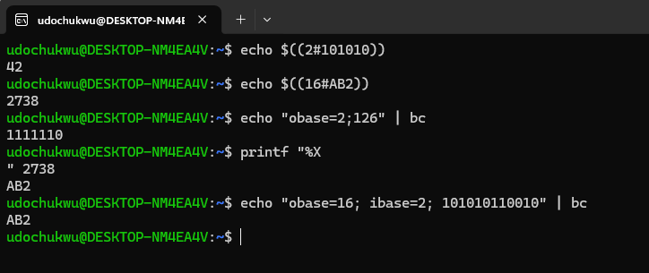

```python
print(int('101010', 2))
print(int('AB2', 16))
print(bin(126))
print(hex(2738))
```

**Figure 2.** Validation with Python.

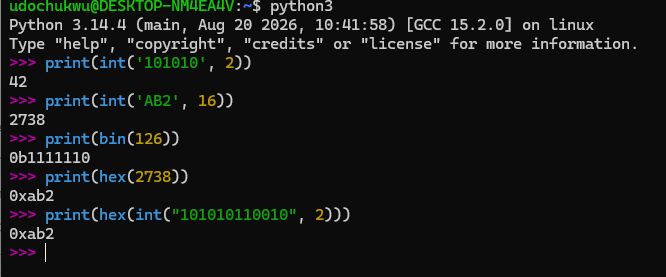

### 3.3 Evidence Table

| Evidence Value | Given Base | Manual Answer | Verification Command | Screenshot |
| --- | --- | --- | --- | --- |
| `101010` | Binary | `42` | `echo $((2#101010))` | Fig. 1 |
| `AB2` | Hexadecimal | `2738` | `echo $((16#AB2))` | Fig. 1 |
| `126` | Decimal | `1111110` | `echo "obase=2;126" \| bc` | Fig. 1 |
| `2738` | Decimal | `AB2` | `printf "%X" 2738` | Fig. 1 |
| `101010110010` | Binary | `AB2` | `echo "obase=16; ibase=2; 101010110010" \| bc` | Fig. 1 |

All manual answers match the shell and Python output.

---

## 4. Task B: ASCII, UTF-8 and Hex Evidence Strings

Digital evidence is stored as bytes. A byte can be an ASCII character, part of a Unicode character, a number, or raw binary data.

### 4.1 Text to Hex and Back

```bash
echo -n "Hello" > evidence_text.txt
cat evidence_text.txt
xxd evidence_text.txt
xxd -p evidence_text.txt

# Hex back to text
printf "48656c6c6f" | xxd -r -p
```

```python
import binascii
text = b'Hello'
print('ASCII bytes:', text)
print('ASCII to hex:', binascii.hexlify(text).decode())
print('Hex to ASCII:', binascii.unhexlify('48656c6c6f').decode())
print('ord(H):', ord('H'))
print('chr(72):', chr(72))
```

### 4.2 Student Exercise

Task: create `Udochukwu_lab1a.txt` containing `Digital Forensics Begins With Bytes`, display it with `xxd`, extract the plain hex, and convert it back to text.

```bash
echo "Digital Forensics Begins With Bytes" > Udochukwu_lab1a.txt
xxd Udochukwu_lab1a.txt
xxd -p Udochukwu_lab1a.txt
printf "4469676974616c20466f72656e7369637320426567696e7320576974682042797465730a" | xxd -r -p
```

**Figure 3.** Commands and output for the exercise in section 4.2.

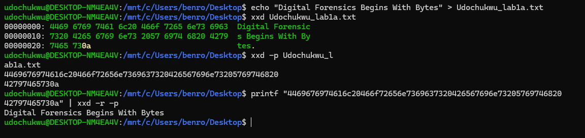

### 4.3 Findings

**Why does `0A` appear at the end of the output?**
`echo` without `-n` appends a newline character to the text. In ASCII and hexadecimal, a newline is the byte `0A`. In Figure 3 the final `0a` is the last byte of the dump.

**Why should an examiner not assume every hex value is readable text?**
Hexadecimal is only a way of displaying raw bytes. The meaning of those bytes depends on the file format, the encoding and how the application interprets them. The byte `0x41` is the letter `A` in ASCII, but in another context it could be part of a number, colour data, a machine instruction, a compressed stream or encrypted content.

---

## 5. Task C: Epoch Time and Forensic Timestamps

Timestamps drive forensic timelines. A wrong conversion can place a suspect's action at the wrong moment.

### 5.1 Unix Epoch Conversion

Unix time counts seconds since `1970-01-01 00:00:00 UTC`.

```bash
date +%s
date -u -d @1643643491
```

```python
from datetime import datetime, timezone
print(datetime.fromtimestamp(1643643491, tz=timezone.utc))
```

**Figure 4.** Unix epoch conversion.

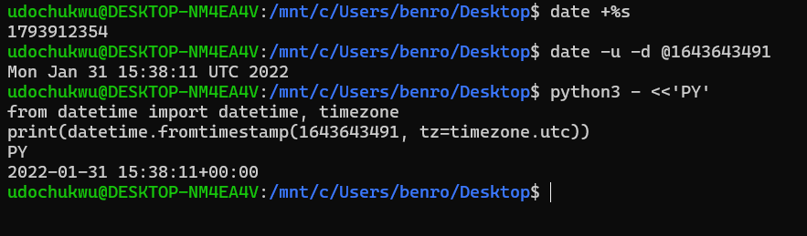

### 5.2 Local Time versus UTC

```bash
date
date -u
```

```python
from datetime import datetime, timezone
print('Local:', datetime.now())
print('UTC  :', datetime.now(timezone.utc))
```

**Figure 5.** Local time compared with UTC (local is UTC-03:00).

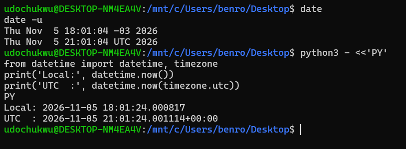

### 5.3 Mac Absolute Time (Cocoa Core Data)

Mac Absolute Time counts seconds since `2001-01-01 00:00:00 UTC`. The offset between the Unix and Mac epochs is **978,307,200 seconds**.

```python
from datetime import datetime, timezone

unix_epoch = datetime(1970, 1, 1, tzinfo=timezone.utc)
mac_epoch  = datetime(2001, 1, 1, tzinfo=timezone.utc)
print(int((mac_epoch - unix_epoch).total_seconds()))

mac_value  = 725846400
unix_value = mac_value + 978307200
print(datetime.fromtimestamp(unix_value, tz=timezone.utc))
```

**Figure 6.** Mac Absolute Time conversion and epoch offset.

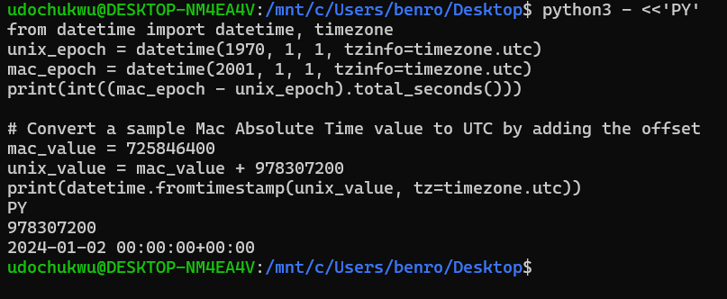

**Figure 7.** Conversion of Unix timestamp `1675008832` to readable UTC.

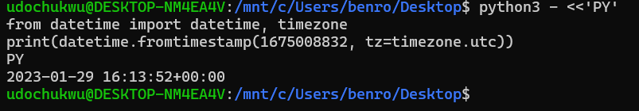

### 5.4 Timestamp Worksheet

| Timestamp Value | Format | Conversion Method | Readable UTC Result | Screenshot |
| --- | --- | --- | --- | --- |
| `1643643491` | Unix seconds | `datetime.fromtimestamp(1643643491, tz=timezone.utc)` | `2022-01-31 15:38:11+00:00` | Fig. 4 |
| `1675008832` | Unix seconds | `datetime.fromtimestamp(1675008832, tz=timezone.utc)` | `2023-01-29 16:13:52+00:00` | Fig. 7 |
| `725846400` | Mac Absolute Time | `mac_value + 978307200`, then convert as Unix | `2024-01-02 00:00:00+00:00` | Fig. 6 |
| Current time | Unix seconds | `date -u` | `Thu Nov  5 21:01:04 UTC 2026` | Fig. 5 |

> **Timeline warning:** Always state whether a result is UTC or local time. Timezone mistakes can seriously weaken the reliability of forensic findings.

---

## 6. Task D: Hashing and the Newline Problem

Hashing verifies that evidence has not changed. A single extra newline byte produces a completely different hash.

### 6.1 Two Similar Files

```bash
echo "Hello"    > hello_with_newline.txt
echo -n "Hello" > hello_without_newline.txt

xxd hello_with_newline.txt
xxd hello_without_newline.txt

md5sum    hello_with_newline.txt hello_without_newline.txt
sha256sum hello_with_newline.txt hello_without_newline.txt
```

**Figure 8.** Creation, `xxd` comparison and hashes of the two files.

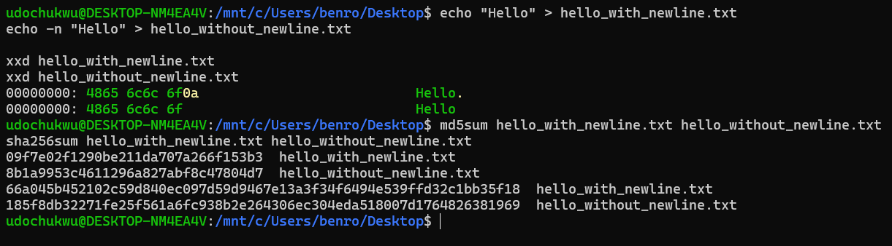

### 6.2 Hash Comparison

| File | Bytes (hex) | MD5 | SHA-256 |
| --- | --- | --- | --- |
| `hello_with_newline.txt` | `48 65 6c 6c 6f 0a` | `09f7e02f1290be211da707a266f153b3` | `66a045b452102c59d840ec097d59d9467e13a3f34f6494e539ffd32c1bb35f18` |
| `hello_without_newline.txt` | `48 65 6c 6c 6f` | `8b1a9953c4611296a827abf8c47804d7` | `185f8db32271fe25f561a6fc938b2e264306ec304eda518007d1764826381969` |

### 6.3 Student Exercise

Two files were created with `echo` and `echo -n`, compared with `xxd`, and hashed with MD5 and SHA-256.

```bash
echo -n "Hello" > udochukwu_file1.txt   # no newline
echo "Hello"    > udochukwu_file2.txt   # with newline
xxd udochukwu_file1.txt
xxd udochukwu_file2.txt
md5sum    udochukwu_file1.txt udochukwu_file2.txt
sha256sum udochukwu_file1.txt udochukwu_file2.txt
```

**Figure 9.** Student exercise: byte comparison and hashes.

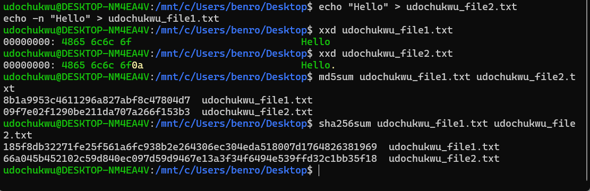

| File | Created with | Final byte | MD5 |
| --- | --- | --- | --- |
| `udochukwu_file1.txt` | `echo -n` | `6f` | `8b1a9953c4611296a827abf8c47804d7` |
| `udochukwu_file2.txt` | `echo` | `0a` | `09f7e02f1290be211da707a266f153b3` |

### 6.4 Findings

- File 1 holds the characters `H e l l o` only. File 2 holds the same characters plus the newline byte `0A`.
- Both files look the same on screen, but the underlying bytes differ.
- Cryptographic hashes are byte-sensitive, so the MD5 and SHA-256 values differ completely.
- To hash **exactly the visible characters**, use `echo -n` (or `printf` without a trailing newline).

---

## 7. Task E: Endianness and Data Stored in Memory

Endianness is the order in which the bytes of a multi-byte value are stored. Examiners must account for it when reading raw memory, file structures, disk metadata and binary fields.

### 7.1 Check System Byte Order

```python
import sys
print('System byte order:', sys.byteorder)
```

Result: `little`

### 7.2 Interpret the Same Bytes Two Ways

```python
raw = bytes.fromhex('78563412')
print('Raw bytes:', raw.hex())
print('Interpreted as little-endian:', int.from_bytes(raw, 'little'))
print('Interpreted as big-endian   :', int.from_bytes(raw, 'big'))
```

**Figure 10.** System byte order and interpretation of `78563412`.

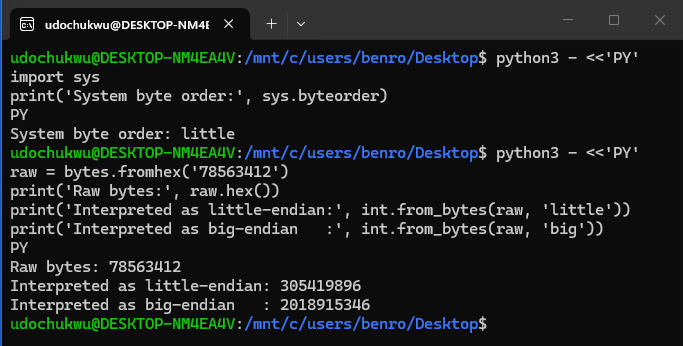

### 7.3 Endianness Worksheet

| Raw Hex Bytes | Little-Endian Decimal | Big-Endian Decimal | Explanation |
| --- | --- | --- | --- |
| `01000000` | 1 | 16,777,216 | Little-endian reads `00 00 00 01` = `0x00000001`. Big-endian reads `0x01000000`. |
| `FF000000` | 255 | 4,278,190,080 | Little-endian reads `0x000000FF`. Big-endian reads `0xFF000000`. |
| `00000100` | 65,536 | 256 | Little-endian reads `0x00010000`. Big-endian reads `0x00000100`. |
| `78563412` | 305,419,896 | 2,018,915,346 | Little-endian reads `0x12345678`. Big-endian reads `0x78563412`. |

Command used for each row (only the hex string changes):

```python
raw = bytes.fromhex('01000000')
print('Raw bytes:', raw.hex())
print('Interpreted as little-endian:', int.from_bytes(raw, 'little'))
print('Interpreted as big-endian   :', int.from_bytes(raw, 'big'))
```

### 7.4 Findings

The same four bytes are stored identically, but the numeric value depends on which end of the sequence is treated as the most significant byte. Little-endian puts the least significant byte first; big-endian puts the most significant byte first. In forensics, disk metadata, file headers and memory structures often use a fixed byte order that may differ from the examiner's own system. Reading a field with the wrong order gives a wrong size, offset, timestamp or address, which can mislead an investigation.

---

## 8. Task F: Mini Forensic Interpretation Case

### 8.1 Evidence Table

| ID | Value | Interpretation | Method / Command |
| --- | --- | --- | --- |
| EVID-001 | `48656c6c6f204943444641` | **Hello ICDFA** | `echo "48656c6c6f204943444641" \| xxd -r -p` |
| EVID-002 | `01001000 01101001` | **Hi** | Binary to ASCII conversion (`xxd -r -b`) |
| EVID-003 | `1675008832` | **Sun Jan 29 16:13:52 UTC 2023** | `date -u -d @1675008832` |
| EVID-004 | `725846400` (Mac Absolute Time) | **2024-01-02 00:00:00+00:00** | `mac_epoch + timedelta(seconds=725846400)` |
| EVID-005 | `78563412` | **Big-endian: 2018915346**, **Little-endian: 305419896** | `int.from_bytes(data, byteorder=...)` |

**Figure 11.** Commands and output for the mini-case evidence.

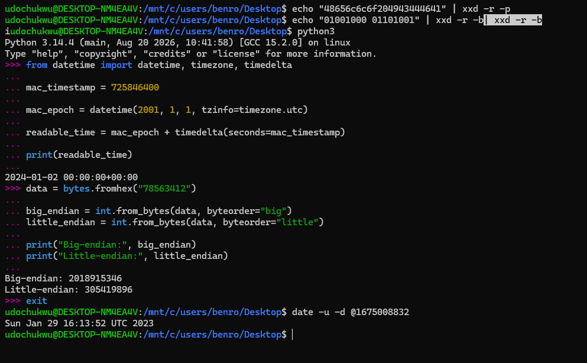

### 8.2 Case Narrative

#### EVID-001: Hexadecimal decoding

Each pair of hex digits is one byte, which maps to one ASCII character.

| Hex | 48 | 65 | 6c | 6c | 6f | 20 | 49 | 43 | 44 | 46 | 41 |
| --- | --- | --- | --- | --- | --- | --- | --- | --- | --- | --- | --- |
| ASCII | H | e | l | l | o | (space) | I | C | D | F | A |

**Result:** `Hello ICDFA`. This is text stored in hexadecimal encoding, the kind of data recovered from files, memory dumps or network traffic.

#### EVID-002: Binary decoding

Each group of eight bits is one byte.

| Binary | Decimal | ASCII |
| --- | --- | --- |
| `01001000` | 72 | H |
| `01101001` | 105 | i |

**Result:** `Hi`. A short text message stored as binary and converted to readable ASCII.

#### EVID-003: Unix timestamp

Unix time is the number of seconds since `1970-01-01 00:00:00 UTC`.
**Result:** `1675008832` = **29 January 2023, 16:13:52 UTC**. Useful for reconstructing when files were created or modified and for correlating events across devices.

#### EVID-004: Mac Absolute Time

Mac Absolute Time is the number of seconds since `2001-01-01 00:00:00 UTC`.
**Result:** `725846400` = **2 January 2024, 00:00:00 UTC**. Useful for timeline reconstruction on macOS and other Apple systems.

#### EVID-005: Byte order

The four bytes are `78 56 34 12`. Big-endian gives `2018915346`; little-endian gives `305419896`. Identifying the correct byte order is essential when examining binary files, memory dumps and file headers.

### 8.3 Forensic Significance

- **Timeline analysis:** EVID-003 and EVID-004 establish when events occurred and help correlate activity across systems.
- **Content interpretation:** EVID-001 and EVID-002 recover readable information from encoded data.
- **Structure interpretation:** EVID-005 shows that a wrong assumption about byte order produces misleading numeric values.

Overall, accurate interpretation requires identifying the data representation, applying the right decoding method and documenting the result clearly.

---

## 9. Reflection

Number systems and timestamps matter in digital forensics because evidence is often stored in forms humans cannot read directly. Binary and hexadecimal let an examiner decode text and data held in files and memory. Timestamps establish when activity happened, which makes it possible to reconstruct event sequences and build accurate timelines. Formats such as Unix time and Mac Absolute Time use different reference dates, so the correct conversion must be applied to avoid false conclusions. Together with an understanding of byte order, these skills let investigators interpret evidence accurately, build reliable timelines and protect the integrity of their findings.

---

## 10. Figure Index

| Figure | Description | File |
| --- | --- | --- |
| 1 | Shell validation of conversions | `images/fig01_shell_validation.png` |
| 2 | Python validation of conversions | `images/fig02_python_validation.png` |
| 3 | ASCII and hex student exercise | `images/fig03_ascii_hex_exercise.png` |
| 4 | Unix epoch conversion | `images/fig04_unix_epoch_conversion.png` |
| 5 | Local time vs UTC | `images/fig05_local_vs_utc.png` |
| 6 | Mac Absolute Time conversion | `images/fig06_mac_absolute_time.png` |
| 7 | Unix timestamp `1675008832` to UTC | `images/fig07_unix_1675008832.png` |
| 8 | Hashing with and without newline | `images/fig08_hash_hello_newline.png` |
| 9 | Student hash exercise | `images/fig09_hash_student_exercise.png` |
| 10 | Endianness output | `images/fig10_endianness.png` |
| 11 | Mini-case evidence commands | `images/fig11_mini_case_evidence.png` |

---

## 11. Repository Structure

```
CIP-B101_Lab1A/
├── README.md
└── images/
    ├── fig01_shell_validation.png
    ├── fig02_python_validation.png
    ├── fig03_ascii_hex_exercise.png
    ├── fig04_unix_epoch_conversion.png
    ├── fig05_local_vs_utc.png
    ├── fig06_mac_absolute_time.png
    ├── fig07_unix_1675008832.png
    ├── fig08_hash_hello_newline.png
    ├── fig09_hash_student_exercise.png
    ├── fig10_endianness.png
    └── fig11_mini_case_evidence.png
```

---

## 12. References

- [GNU Bash Manual: Shell Arithmetic](https://www.gnu.org/software/bash/manual/html_node/Shell-Arithmetic.html)
- [Linuxize: Bash printf command](https://linuxize.com/post/bash-printf-command/)
- [Wikipedia: Unicode](https://en.wikipedia.org/wiki/Unicode)
- [Wikipedia: Coordinated Universal Time](https://en.wikipedia.org/wiki/Coordinated_Universal_Time)
- [Stack Overflow: Why is an MD5 hash created by Python different from one created using echo and md5sum](https://stackoverflow.com/questions/5693360/why-is-an-md5-hash-created-by-python-different-from-one-created-using-echo-and-m)
- [IAR: Migration techniques for different endianness](https://www.iar.com/knowledge/learn/programming/migration-techniques-for-different-endianness/)

---

*International Cybersecurity and Digital Forensics Academy (ICDFA) | Student Practical Laboratory*
